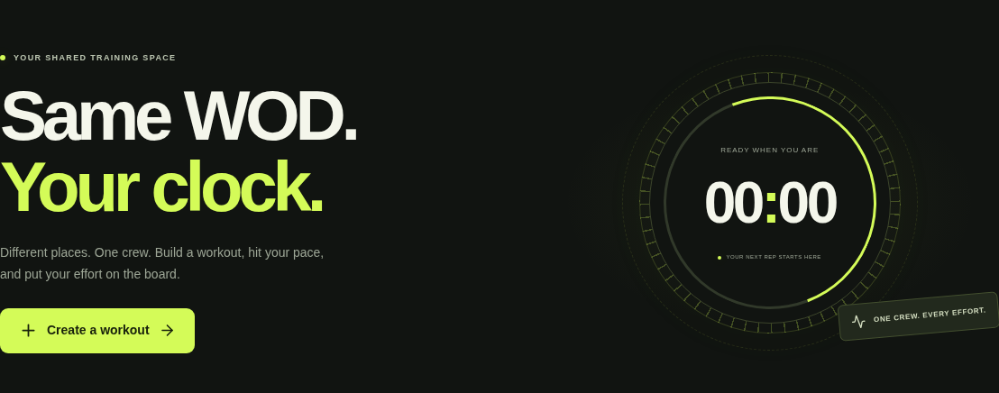

# WOD Crew

**Same WOD. Your clock.** Train with your friends, even when you cannot train together.

## Why I built WOD Crew

I’m Italian and I live in Poland, while many of friends are in Italy. We share a passion for crossfit, but training together across countries isn’t easy.

I started WOD Crew as a personal project so we could share workouts and keep each other going. AI-assisted development helped me turn that idea into something real. I think AI skills can be useful for more than our jobs — sometimes they help us build something personal that makes life a little better.

I’m sharing the source code so other friends can build a space of their own.

## WOD Crew — Community Playground

**[Try the WOD Crew Community Playground — Live Demo](https://wod-crew-community.stefano-ciurlia01.chatgpt.site)**

Want to give WOD Crew a try? Jump into the Community demo, create your own little training space, explore the workouts, and give the timer a spin!

Just a heads-up: this is a playground, not a permanent training service. Your workouts are saved in the demo, but your browser holds the key to your space. If you clear your browser data or switch devices, you may lose access to your previous workouts — even with the same name.

Like it? Grab the source and build your own WOD Crew to train with your friends!

Use this project as a starting point for **your own crew, your own workouts, and your own app** with ChatGPT Work.

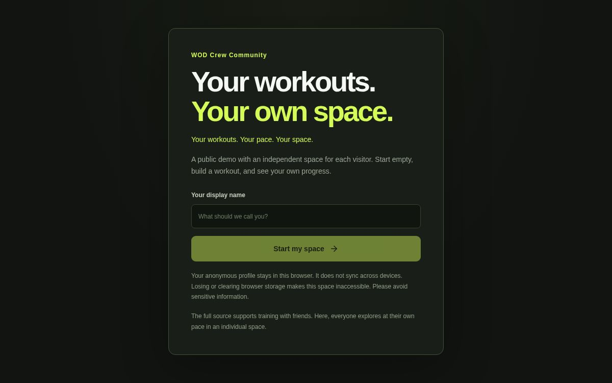

*This is the demo’s welcome screen: choose a display name to start exploring your own space.*

## What you can do

- Build workouts with AMRAP, For Time, EMOM, Tabata, intervals, stopwatch, and rest blocks.
- Combine exercises and blocks, set work/rest periods, and repeat rounds.
- Run a workout at your own pace with a timer, sound cues, and optional vibration.
- Log results from the timer or manually, including Rx/scaled notes.
- Share workouts with a crew and follow training activity over time.
- Browse WOD examples, remix them, and save favorites on your device.

### A board full of real workouts

These are workouts I created and used with my crew: different formats, exercises, and training days, all in one place.

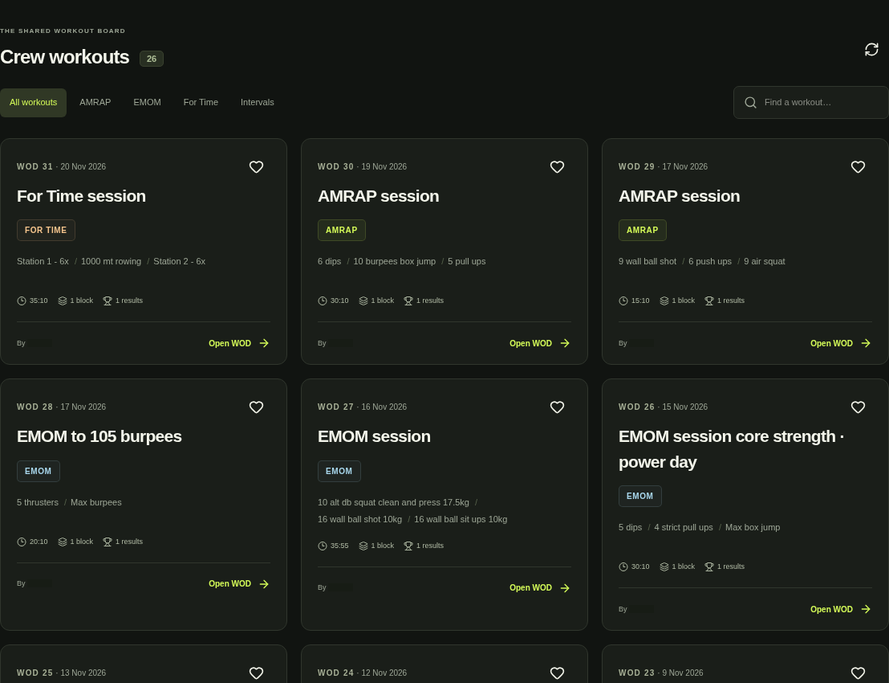

### Open a WOD and see the full plan

Each workout has its exercises, timing, rounds, and a shortcut to previous attempts. This EMOM repeats the full exercise list inside each interval.

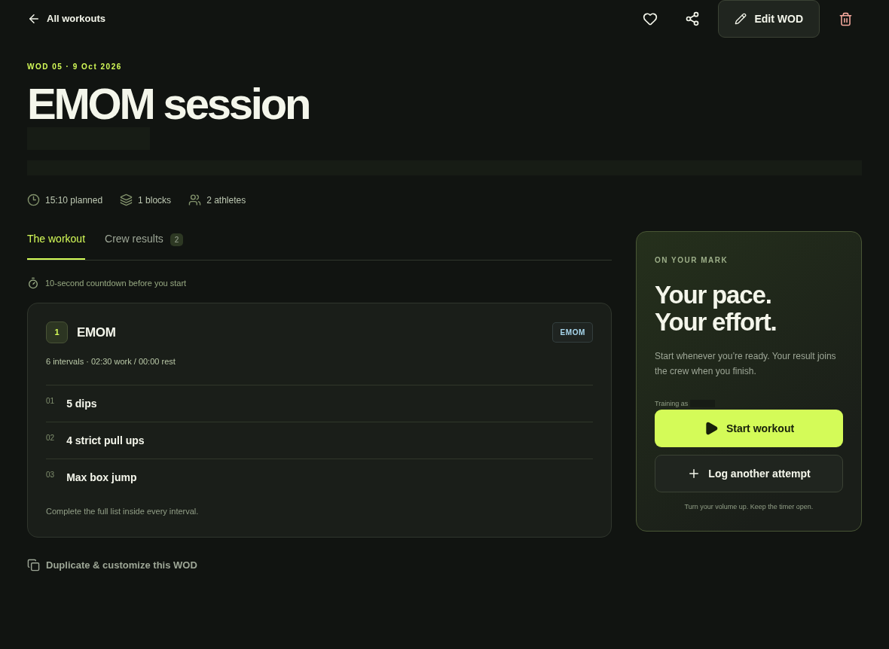

### Build it your way

Combine blocks, set the work and recovery, and customize the session for your crew.

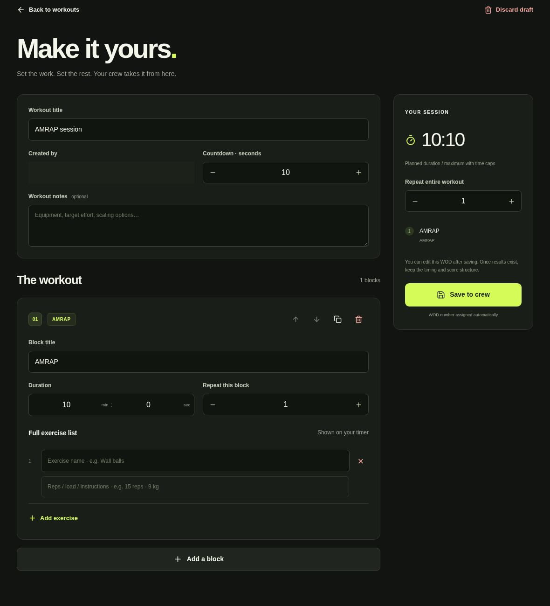

### Train on your own clock

The timer shows the current work, interval, elapsed time, and pause/resume controls. Everyone can run the same WOD independently. For quick access on your phone, [add WOD Crew to your Home Screen](#pro-tip-put-wod-crew-on-your-home-screen).

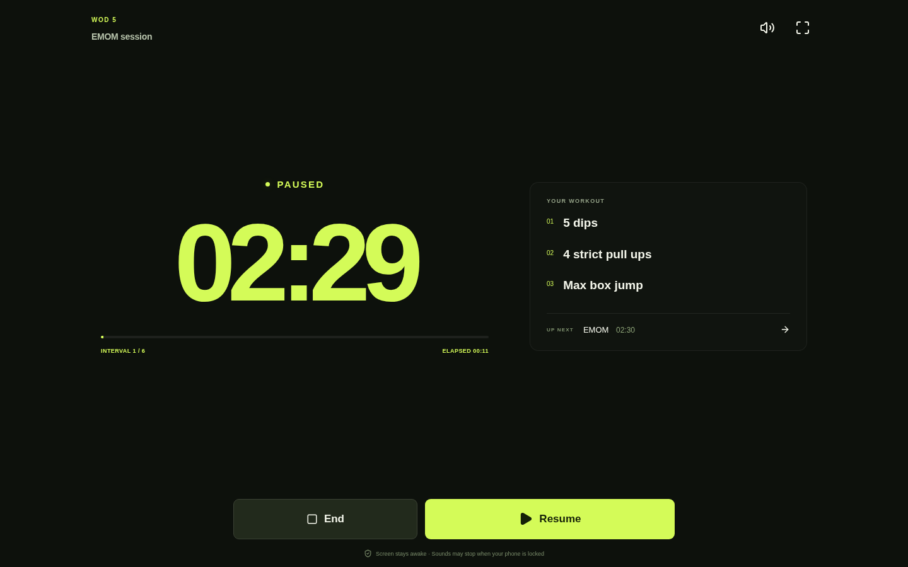

See the timer on a phone

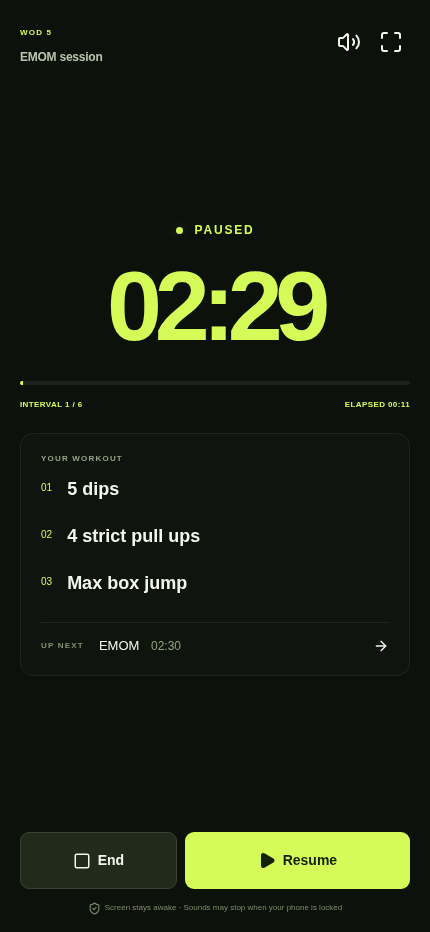

### Every attempt counts

A real result history from my crew: repeat attempts, Rx/scaled labels, completed intervals, and training dates. Names and identifying notes are hidden in the screenshots.

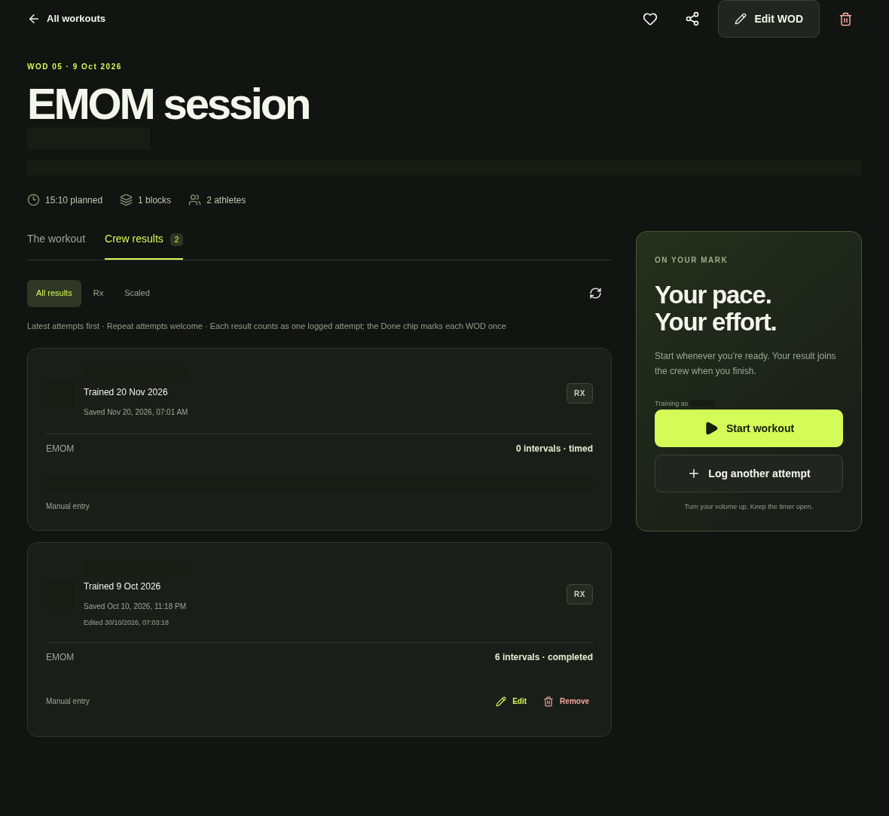

See the result logging form

Record a training date, confirm completed work, choose Rx or scaled, and add notes. The form shown here was opened for the screenshot without saving an attempt.

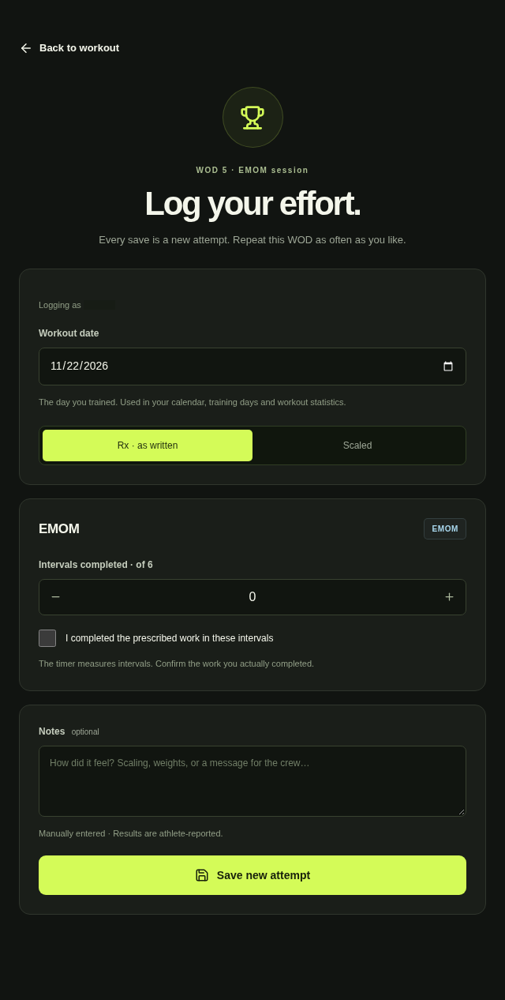

### Watch your consistency grow

Weekly, monthly, and yearly views track workouts and distinct training days. Explore the chart, the week-by-week summary, and the bigger picture over time.

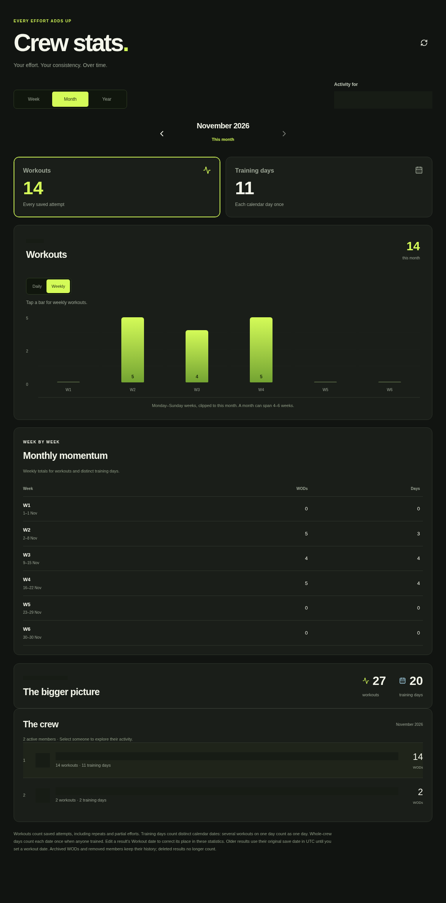

### Find your next session

Browse the WOD library and adapt an example into your own editable workout.

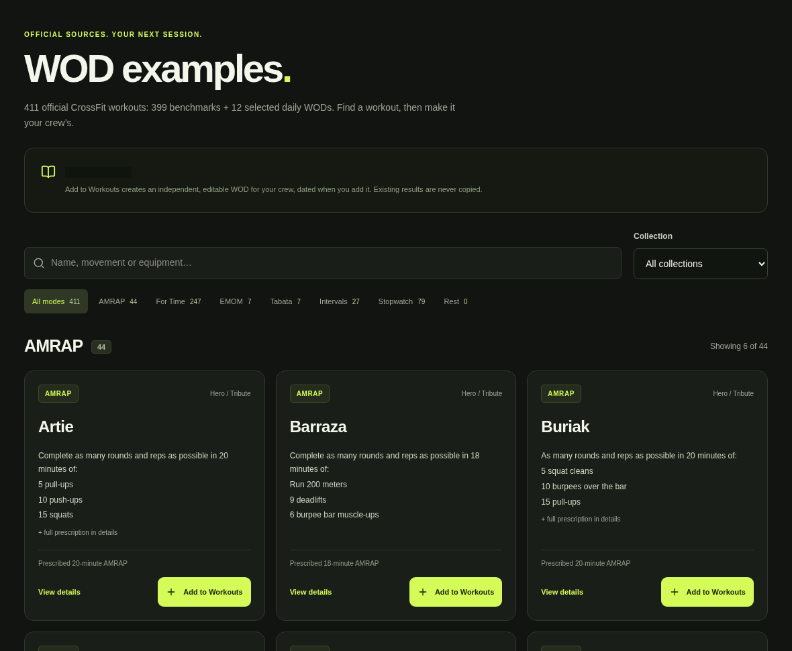

These screenshots come from the WOD Crew I use with my friends. They show our workouts and real saved attempts, with names and identifying notes hidden. I’m sharing the code. Your copy starts with an empty database and comes without our saved workouts, results, browser recovery keys, or production Site configuration.

## Pro tip: put WOD Crew on your Home Screen

One tap and you’re ready to train. Open your crew’s **published Site link** in your phone’s browser, then add it to the Home Screen:

- **iPhone · Safari:** tap **Share** (or open the page menu, then Share), choose **Add to Home Screen**, name it **WOD Crew**, enable **Open as Web App** if shown, and tap **Add**. You can move the icon into your Fitness folder, just like any other app. If the action is missing, look under **Edit Actions**. [Apple’s guide](https://support.apple.com/guide/iphone/bookmark-a-website-iph42ab2f3a7/ios).
- **Android · Chrome:** open the **⋮** menu, choose **Install and create shortcut → Create shortcut**, name it **WOD Crew**, and tap **Add**. Depending on your Chrome version, the option may be called **Add to Home screen**; if an **Install** option is offered, you can use that instead. A shortcut may open in Chrome rather than a separate app window. [Google’s guide](https://support.google.com/chrome/answer/15085120?co=GENIE.Platform%3DAndroid&hl=en).

The Home Screen icon opens your published **ChatGPT Site**. It’s still a website, with the same access controls. You’ll need an internet connection to load workouts and save results.

## Make it yours with ChatGPT Work

Connect this repository in ChatGPT Work and use this prompt:

> Use `source/` as the starting point for a new, independent WOD Crew app. Read `source/README.md` first. Keep the workout builder, timer, crew, results, and statistics. Create a NEW Site with its own project ID and a NEW D1 database bound as DB. Replace the placeholder in `source/.openai/hosting.json` with the newly returned Site ID. Apply all six SQL migrations in `source/drizzle/` in order to the new database. Start empty, or use `source/examples/demo-seed.sql` for fictional demo content only. Install the pinned dependencies, run the existing tests, build, and let me preview it before publishing. Do not reuse or access the original WOD Crew Site, database, credentials, or users.

Sites availability and deployment depend on your ChatGPT Work account. This is a source project to scaffold from, not a one-click installer.

**[Browse the full source →](source/)** · **[Setup and folder structure →](source/README.md)** · **[Database schema →](source/db/schema.ts)**

## A small friends’ app

Crew selection is intentionally based on trust: choosing a member is **not authentication**. Anyone with access to an instance can select a crew member and manage their entries. Keep your own instance limited to people you trust, or add real per-user authentication and authorization before using it with a wider audience.

WOD Crew is an independent personal project and is not affiliated with or endorsed by CrossFit. Adapt the sessions to your experience and ability.

## Reuse

I’m sharing the code under the [MIT license](LICENSE). Included third-party code keeps its own license notices. Workout catalog entries link to their original sources; the project license does not relicense third-party workout descriptions or branding.

If you make your own version, I hope it gives your crew one more reason to turn up. Every effort counts.
